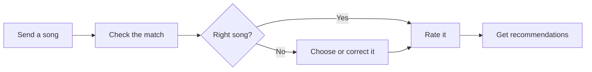
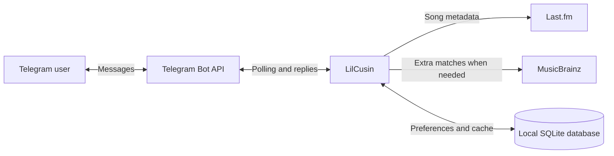

# LilCusin 🎵

A Telegram bot that learns what music you like. Send it a song, rate the match,
and ask for recommendations.

> Try sending `Radiohead - Creep` in a private chat. You can also send or forward
> Telegram audio that has an artist and title.

## What happens when you send a song



By default identification uses song **metadata** (artist and title). Optional
[music recognition](RECOGNITION.md) listens to samples from audio, video, voice
messages and supported YouTube links through ShazamIO (no API key). Set `RECOGNITION_ENABLED=false` to disable it.
Music-file uploads go to rating via metadata; they do not automatically run audio
recognition. Reply to unknown audio with `/recognize` to request fingerprinting.
An optional **Get song** button can fetch a permitted individual recording and send
a playable private Telegram music message. It is disabled by default; see
[Get song setup, permissions and verification](GET_SONG.md). Ratings are ❤️ Love, 👍 Like, 😐 Neutral, and 👎 Dislike.
Use **For You** for a list based on your taste, or **More Like This** to start
from one song.

## Run your own bot

You need Python 3.12 or 3.13, a [Telegram bot token from @BotFather](https://t.me/BotFather),
and a [Last.fm API key](https://www.last.fm/api/account/create). Your computer
or server must be able to reach the APIs described in [Network access](#network-access).

1. **Install the Python packages.** From this repository's folder:

   ```bash
   python -m venv .venv
   ```

   Activate the environment, then install:

   | System | Activate with |
   | --- | --- |
   | macOS / Linux | `source .venv/bin/activate` |
   | Windows PowerShell | `.venv\Scripts\Activate.ps1` |

   ```bash
   python -m pip install -r requirements.txt -r requirements-audio.txt
   ```

   For Debian 13 / Python 3.13, offline preflight and safe systemd upgrades, follow
   [the deployment procedure](DEPLOYMENT.md). Get Song also requires system FFmpeg/ffprobe.

2. **Create your private configuration file.** Copy `.env.example` to `.env`,
   then open `.env` and fill in the empty values. On macOS/Linux, use
   `cp .env.example .env`; on Windows PowerShell, use
   `Copy-Item .env.example .env`.

   | Setting | Put this in `.env` |
   | --- | --- |
   | `TELEGRAM_BOT_TOKEN` | The token from BotFather |
   | `LASTFM_API_KEY` | Your Last.fm API key |
   | `TELEGRAM_API_BASE_URL` | `https://api.telegram.org` (default, direct access). Override only when a relay is explicitly required. |
   | `LIL_BRO_BOT_USERNAME` | Optional username for the related bot; leave the example value unless you use a different bot |

3. **Start the bot.**

   ```bash
   python -m music_bot
   ```

Open your bot in Telegram and send `/start`. Keep the process running to receive
messages. LilCusin uses **polling**, so it needs no public inbound port. Run only
one copy for a bot token, and do not set a webhook for the same bot. If the bot
already runs on a VPS, stop that copy before starting another one.

> **Keep secrets private:** `.env` and the local database are ignored by Git.
> Never commit, screenshot, or paste real tokens, API keys, or user data. If a
> secret was ever committed, rotate it; deleting a file does not erase Git history.

## What can I do in Telegram?

| Action | What happens |
| --- | --- |
| Type a song name, optionally `Artist - Song title`, or use `/search` | Search catalogues and choose the matching song; Get song is the primary delivery action. |
| Send a music file, or reply to it with `/rate` | Match its tags and show rating controls. Missing or unmatched tags prompt for corrected names; no automatic fingerprinting or file download. |
| Rate a confirmed song | Love and Like teach **For You** your preferences. You can change a rating later. |
| Tap **More Like This** | Find songs related to the selected song, even before rating it. |
| `/taste` or `/profile` | See your taste summary or rating counts. |
| `/connectchannel` | Optionally connect a playlist channel; new audio posts can become weak taste signals after identification. |
| `/privacy` or `/forgetme` | Read what is stored or remove your personal records. |
| `/version` | Show the content-based build identifier for the running bot. |

If a match is wrong, choose another candidate or reply to the correction prompt
with a song name (the artist is optional). `/cancel` closes an unfinished search. The match is
based on metadata and can be wrong even when the names look similar.

Search and version results have **Close** controls. Delivery keeps one status
message with contextual cancellation, retry, and recording choices. Ratings after
delivery are optional. Recently expired song controls can recover using retained
owner and message context; cancelled or deleted-account controls cannot.

Normal private messages accept a song title alone, such as `hello`, `Creep`, or
`همسفر` (2–240 characters). Chat and the Mini App share the same query parser and
title-search service. It combines Last.fm, MusicBrainz, iTunes and optional Deezer metadata. Chat uses bounded provider calls and suitable local matches first. If uploaded performer tags contain extra credits, an exact-title recovery lookup can offer a plausible artist match for explicit confirmation. Relevant title-prefix matches use Deezer popularity rank when available, otherwise public Last.fm listener counts. Popular longer titles can rank above obscure exact titles. Other partial matches
remain available below them. Title-only searches show up to 20 results and require a choice
before confirming a song; they never create a rating automatically. Corrections
also accept a title without an artist. Existing owner checks, expiry, search-attempt
limits and `/cancel` apply, with no extra configuration or database migration.
The full isolated Linux suite passed 231 tests, including title search, relevance,
provider fallback and owner checks. A live `hello` search ranked Adele's exact
title first, followed by other exact-title matches. The user verified title-only
chat search and selection; production deployment remains deferred.

Telegram short-title searches also use bounded, metadata-only YouTube discovery
when enabled, validating artist/title hints against catalogues before offering a
choice. This can surface unreleased songs and recover small spelling mistakes.
Observed upload views rank these discovery suggestions and are labelled separately
from catalogue popularity; they are not total song plays. Results are cached for
fifteen minutes. See [measurements and limits](docs/discovery-popularity-2026-10-17.md).

## Technical details

### Telegram Mini App

Lil Cusin includes a mobile interface with **For You**, **Search**, **Channels**, and **My Taste**.
Telegram users can optionally run `/setup` for three short taste questions: style, mood, and an artist.
These answers choose starter songs without creating ratings. `/setup` revisits
the questions; users with existing music history can keep using their current taste.
The corresponding Mini App setup screens are prepared but await Cloudflare publication.
It shares the bot's SQLite database and recommendation services. Song cards support
Love, Like, Neutral, and Dislike; search accepts a song title alone or
`Artist - Song title`. Ratings apply only to the selected match after listening.
Connected channel songs can be browsed, rated, and identified in the app.
Posts start collecting after channel connection; older posts are not imported.
Available album covers appear on song cards. This is music discovery, not an audio player.

To enable it, set `MINIAPP_URL=https://your-app.example` in `.env`. Forward that
HTTPS origin to `127.0.0.1:8080` with your reverse proxy, including `/api/` paths,
and run the bot normally. `MINIAPP_HOST` and `MINIAPP_PORT` change the bind address.
The bot starts the web server and registers an **Open Lil Cusin** menu button.
Keep the local port private behind the HTTPS proxy. No new Python packages are needed.
An optional main app/profile launch button can also be configured in BotFather.

API calls require Telegram-signed `initData`, checked on the server with a
one-hour maximum age. Expired sessions must reopen the Mini App. Ratings require
a user-owned, unexpired displayed-list token. Authentication data stays in memory
and is never put in URLs or local storage; HTTP access logging is disabled.
Opening the page outside Telegram shows clearly labeled sample data and never
writes real ratings. For a local design preview only, run
`python -m http.server 8080 --directory music_bot/web` and open `http://localhost:8080`.

Leave `MINIAPP_URL` empty to keep running only the chat bot. If the menu button
was previously enabled, reset it through BotFather when disabling the app.

For the deployed `workers.dev` version, the interface lives in the separate
`lilcusin-ui` Worker. The VPS runs `music_bot.miniapp_server` on loopback port
8091 and `music_bot.miniapp_connector` as a separate outgoing HTTPS connection.
The original Telegram polling process can keep running unchanged. The connector
accepts only the declared Mini App API routes and forwards only Telegram authentication
and JSON bodies to that fixed local port. No website domain or Nginx route is needed.

The Worker uses a SQLite-backed Durable Object to keep the connector available;
it does not store song preferences in Cloudflare. Preference data stays in the
existing bot database. Telegram authentication and rating ownership are still
verified by the bot API. The connector credential is stored as a Worker secret
and a private file on the VPS, never embedded in the interface.

To rebuild the Worker from the UI assets, run `python worker/build.py`, then use
the configuration in `worker/wrangler.jsonc` for deployment. Connector and API
services should be supervised and started at boot. Keep the connector secret
outside source control. See `MINIAPP_DEPLOYMENT.md` for this installation's
service names and rollback instructions.

### Where requests and data go



`TELEGRAM_API_BASE_URL` changes only the **Telegram Bot API** origin. It must be
an HTTPS origin such as `https://api.telegram.org`, with no path, query, or
credentials. A trusted relay can be used when Telegram is blocked on the host.

### Network access

The current repository calls Last.fm and MusicBrainz at their normal URLs.
Changing `TELEGRAM_API_BASE_URL` does **not** route those two services. If your
server cannot reach them, their provider clients need a separate relay or other
network route. The bot's song lookup and enrichment depend on those services;
Telegram connectivity alone is not enough.

### Data and privacy

The bot creates `data/music_bot.sqlite3` when it starts. It stores Telegram user
IDs and basic profile fields, song submissions and file identifiers, ratings,
recommendation history, provider metadata, and short-lived button state. The
optional channel feature also stores channel and new-post identifiers. Audio
files are not downloaded, and old channel history is not imported.

`/forgetme` removes the requesting user's profile and related personal records.
Shared song metadata can remain for other users; messages already held by
Telegram and provider-side records are outside this deletion. Read `/privacy`
in the bot for the full in-app explanation. See [SECURITY.md](SECURITY.md) for
reporting and local-data guidance.

### Playlist channels

To connect a channel, send `/connectchannel` privately, make the bot a channel
administrator, and post the one-time code as a **new text post** in that channel.
You must also be its creator or an administrator. Leave optional permissions
such as posting, editing, deleting, and inviting disabled; the bot does not
post there. Only eligible **future** audio posts are processed. Uncertain songs
wait for private review in `/channels`. A channel post is a weak signal, not a
claim that you listened to or liked the song.

### Code map

| Area | Where to look |
| --- | --- |
| Startup and polling | `music_bot/__main__.py` |
| Configuration | `music_bot/config.py`, `.env.example` |
| Song matching | `music_bot/workflow.py`, `music_bot/matching.py` |
| Last.fm and MusicBrainz clients | `music_bot/providers/` |
| Recommendations | `music_bot/recommendations/` |
| Data storage | `music_bot/database.py`, `music_bot/models.py` |
| Tests | `tests/` |

### Tests and live checks

Run the automated tests after installing `requirements.txt`:

```bash
python -m unittest discover -v
python -m compileall -q music_bot tests
```

To check the **real** Last.fm and MusicBrainz APIs, run
`python -m music_bot.validate_sources`. This uses your Last.fm key and makes
external requests, but sends no Telegram messages. Do not run multiple live
validators at once.

### Limits and project status

Identification is not acoustic recognition. Provider coverage and spelling
affect results, including songs written in Persian. Recommendations are
heuristics, not a guarantee that someone will like a song. This is a self-hosted
project with no hosted-service uptime promise. No license is currently included;
reuse permissions have not been specified.

### Guide and language

New listeners get a short three-step guide in Telegram and the Mini App. Use `/help`
to reopen it, `/language` to change language, or the language picker in the app.
Eight languages are available, with Persian/Arabic RTL layout and bundled Vazirmatn.
The app replaces rated song cards with new picks while keeping the rest of the list.
“More like this” opens a song-specific page. Breadcrumbs and Telegram’s back button
restore earlier lists, including search text, scroll position and song controls.
The Mini App guide includes small visual examples of search, listening and rating.
Language, onboarding, and replacement checks live in `tests/test_guidance.py` and
`tests/test_miniapp.py`. Run `node worker/test-ui-navigation.mjs` for the page history
and song-control restoration checks.
Run `node worker/test-ui-recovery.mjs` for interrupted transitions, unavailable
WebView features, stalled preference saves, and authenticated startup failures.


### Search by remembered lyrics

Send a short lyric fragment (at least three words), just as you would a song title.
Short queries (under three words), popular exact titles (at least 10,000 public Last.fm listeners or Deezer rank 400,000), and successful title/artist hints skip the fallback. Longer exact titles without popularity evidence can still receive phrase suggestions, since a lyric fragment often coincides with an obscure song title. Weak phrase
queries additionally discover up to three artist/title hints and validate them against
Last.fm and MusicBrainz. Results require explicit selection before the normal song
card and Get song action; guesses never become automatic ratings or downloads.

`LYRICS_SEARCH_PROVIDER=youtube` is the default free, account-free option. Install
`requirements-audio.txt` (yt-dlp) for this mode; FFmpeg is needed for Get song audio,
not phrase discovery. This searches YouTube's video metadata/search index with the
phrase plus “lyrics”; it is **not a full-text lyrics database or verified lyric match**.
Coverage, spelling tolerance and hosting/IP availability vary. No login, cookies,
challenge solving or access-control bypass is used. The ordinary title search works
if yt-dlp is missing or this optional fallback fails.

For a dedicated lyrics index, set `LYRICS_SEARCH_PROVIDER=musixmatch` and configure
`MUSIXMATCH_API_KEY` privately. This uses the documented `track.search` / `q_lyrics`
API, not full-lyrics downloads. Access, quota and licensing depend on the operator's
API agreement; no free entitlement is assumed. Use `off` to disable phrase discovery.
No new paid service or AI-token dependency is required for the YouTube mode.

Discovery is asynchronous, capped at two simultaneous searches, with a 22-second
budget (12 seconds for the metadata subprocess), at most five video results, three
hints, bounded subprocess output and a 60-second failure cooldown. Generated temporary
directories are removed on success, failure and cancellation. Repeated successful
queries share a bounded in-memory cache for 15 minutes (128 entries); empty results
cache for one minute. Neither raw lyric phrases nor search-page/video payloads are
added to the shared persistent provider cache; only ordinary artist/title catalogue
metadata uses that existing cache. Existing private submissions still contain the
user's input and are removed by `/forgetme`, along with their identification flow;
forgetting also clears the transient phrase cache. Search services receive the
phrase without Telegram identifiers and may retain their own request history.
No full lyrics are fetched, displayed, or republished. Respect each source's terms;
lyric identification does not grant permission to download or redistribute audio.


### Popularity and partial titles

`SEARCH_DEEZER_ENABLED=true` (default) adds anonymous Deezer catalogue **metadata**
to the existing title search; no new account, API key, dependency, previews or audio
are used. Set it to `false` to keep the previous two-provider discovery.
The provider fetches at most 100 results and follows at most one popular longer title
to discover other artists' versions (for example, a short repeated-word title can
complete to its full title). Requests are serialized at one start per second and
use the existing eight-second provider budget, 15-minute search cache and bounded
stale-result fallback. An optional completion failure preserves the original results.

The requesting user's artist hint takes priority. Within relevant title-prefix
matches, popularity precedes exact title length; unrelated titles remain excluded.
When available, one provider's Deezer rank is used consistently for the search;
otherwise Last.fm listener counts are used. Unknown ranks sort after known ranks;
these are provider-specific signals, not an exact universal measure of popularity.
The two metrics are stored separately in cached metadata. No schema migration is
needed; old cache rows still decode. Deezer recording IDs use their own namespace.
Catalogue availability and territorial differences can still affect discovery.
This change does not enable Deezer audio downloads or change source permissions.

## Artist names and short lyric hints

Chat and the Mini App accept artist names (for example `deftones`) as well as song
titles. Short lyric/artist hints such as `someday kanye` can use discovery and then
independent catalogue validation; results always require a choice. No phrase is
hard-coded to a particular song. Artist matches are retained, while popular exact
titles keep precedence when an artist name is ambiguous. Deezer and iTunes metadata
provide additional catalogue paths when Last.fm or MusicBrainz are unavailable.
Install `requirements-audio.txt` for YouTube-based lyric discovery and social links.
Discovery is best-effort and does not establish that lyrics were verified.

## Development record

The recognition/discovery case study is documented in
[case study](docs/case-study.md), [decisions](docs/decisions.md), and
[verification evidence](docs/evidence.md). These distinguish local tests and
user confirmations from production deployment and remaining unverified behavior.

The chat flow, rating controls, delivery performance and metadata recovery changes
are summarized in [the October 17 release record](docs/chat-release-2026-10-17.md).


### Local social-loop additions (not deployed)

The current uncommitted implementation includes consented selected-song comparisons,
reciprocal picks and interaction controls in chat and the Mini App. Bot commands:
`/swaps`, `/savedsongs`, `/socialsettings`; existing `/cardimage` and `/invitations`
remain. Operator review uses `/socialreports` only for explicitly configured
`LILCUSIN_MODERATOR_IDS`. See [contract, tests and release gates](docs/social-loop-release-2026-10-19.md).
